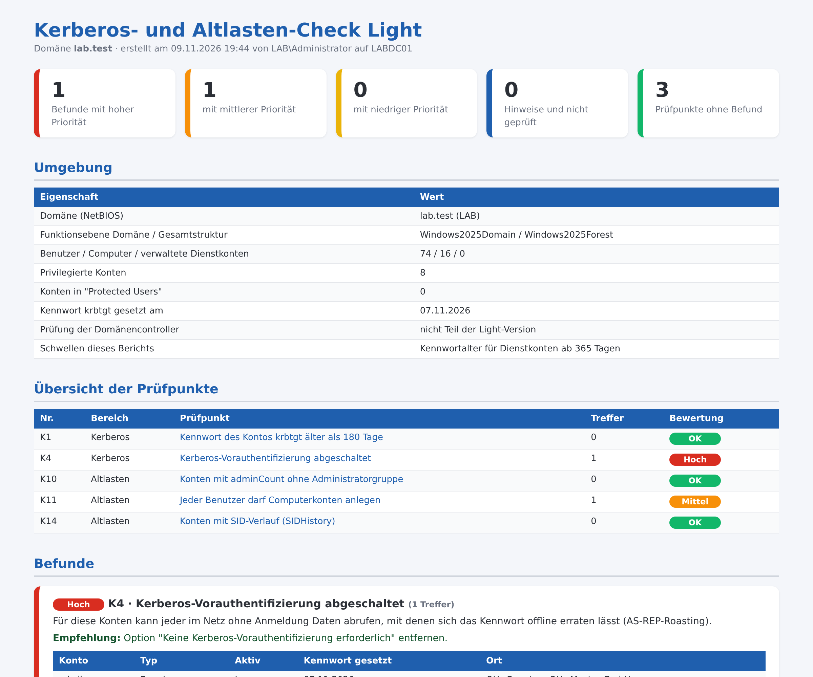

# Kerberos-Altlasten-Check Light – typische Kerberos-Schwachstellen im Active Directory

Kostenloses PowerShell-Skript: prüft Kerberos-Einstellungen, Delegierung und Altlasten im Active Directory in **5 Punkten** und erzeugt einen übersichtlichen **HTML-Bericht auf Deutsch**. Es arbeitet **ausschließlich lesend**: Es ändert nichts, legt nichts an und überträgt keine Daten.



Der gezeigte Bericht stammt aus einer Testdomäne. Das vollständige Beispiel liegt als [Beispielbericht.html](Beispielbericht.html) bei.

## Was geprüft wird

| Nr. | Bereich | Prüfpunkt |
|---|---|---|
| K1 | Kerberos | Kennwort des Kontos krbtgt älter als 180 Tage |
| K4 | Kerberos | Kerberos-Vorauthentifizierung abgeschaltet |
| K10 | Altlasten | Konten mit adminCount ohne Administratorgruppe |
| K11 | Altlasten | Jeder Benutzer darf Computerkonten anlegen |
| K14 | Altlasten | Konten mit SID-Verlauf (SIDHistory) |

Jeder Befund kommt mit Erklärung und Empfehlung.

## Start

```powershell
powershell -ExecutionPolicy Bypass -File .\Kerberos-Altlasten-Check-Light.ps1
```

Alle Optionen zeigt `Get-Help .\Kerberos-Altlasten-Check-Light.ps1 -Detailed`. Voraussetzungen und Rechte stehen im Kopf des Skripts. Getestet mit Windows Server 2019, 2022 und 2025 in Testdomänen (deutsches Windows).

## Vollversion

Die Light-Version enthält 5 von 26 Prüfpunkten (19 %). Die **Vollversion** prüft zusätzlich unter anderem:

- Privilegierte Konten mit Dienstprinzipalnamen (SPN)
- Dienstkonten mit SPN und Kennwort älter als N Tage
- Uneingeschränkte Delegierung außerhalb der Domänencontroller
- Eingeschränkte Delegierung mit Protokollübergang
- Ressourcenbasierte Delegierung eingerichtet
- Konten ohne AES-Verschlüsselung
- Privilegierte Konten, die delegiert werden dürfen
- Gruppe "Prä-Windows 2000 kompatibler Zugriff" enthält Jeder oder Anonymous
- Anonyme LDAP-Abfragen erlaubt
- Vorab angelegte Computerkonten ohne Kennwortpflicht
- Kennwörter in Gruppenrichtlinien (SYSVOL)
- SMBv1 auf Domänencontrollern aktiv
- SMB-Signierung nicht erzwungen
- LDAP-Signierung nicht erzwungen
- LDAP-Kanalbindung nicht immer erzwungen
- Domänencontroller nehmen NTLMv1 an
- LM-Hashwerte werden gespeichert
- Anonyme Zugriffe mit den Rechten von "Jeder"
- Druckwarteschlange läuft auf Domänencontrollern
- Kerberos-Verschlüsselung nicht auf AES beschränkt
- LDAP-Signierung unter Windows Server 2025 nicht ausdrücklich festgelegt

➜ **[Vollversion auf Gumroad](https://mueller86.gumroad.com/l/zptvct)** · **[Vollversion auf Etsy](https://www.etsy.com/listing/4593092377)** · **[alle Prüfskripte im Shop](https://www.etsy.com/shop/ITAdminToolsbyMM)**

## Hinweise

- Der Bericht enthält Konto-, Rechner- oder Servernamen – bitte vertraulich behandeln.
- Der Bericht zeigt Auffälligkeiten anhand fester Regeln. Er ersetzt keine Sicherheitsprüfung und erhebt keinen Anspruch auf Vollständigkeit.
- Nutzung auf eigene Verantwortung, siehe [LICENSE](LICENSE).
- Bei der Ausarbeitung wurden KI-Werkzeuge unterstützend eingesetzt; Inhalte und Skript wurden fachlich geprüft und im Testlab getestet.

---

### English

Free, read-only PowerShell script that checks Kerberos settings, delegation and legacy leftovers in Active Directory (5 checks, German HTML report with findings and recommendations). No changes are made and no data leaves the machine. Run: `powershell -ExecutionPolicy Bypass -File .\Kerberos-Altlasten-Check-Light.ps1`. The full version with 26 checks: https://mueller86.gumroad.com/l/zptvct
